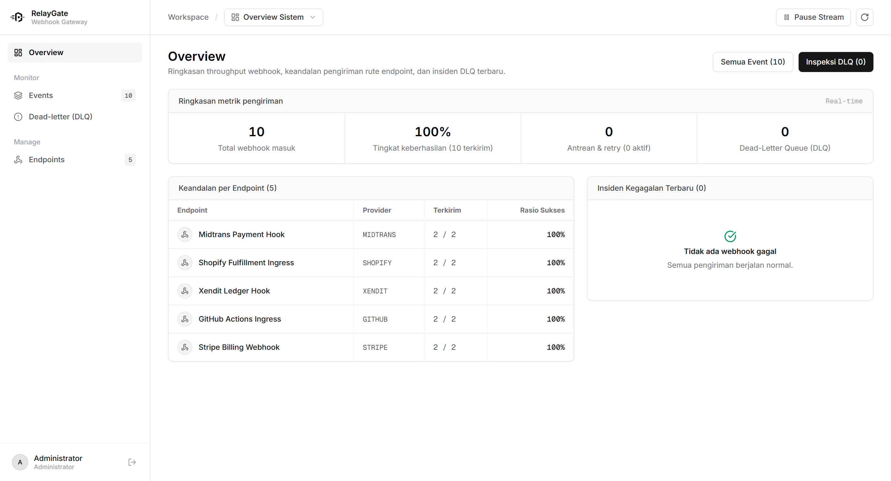

<p align="center">
  <a href="https://github.com/rootless-sec/relaygate">
    
  </a>
</p>

<h1 align="center">RelayGate</h1>

<p align="center">
  Self-hosted webhook ingestion gateway, signature verifier, and dead-letter replay server in a single Go binary with SQLite WAL storage and an embedded React UI.
</p>

<p align="center">
  
</p>

---

`POST /ingest/{endpoint_id}` (or `/v1/webhook/{endpoint_id}`) checks upstream idempotency keys, writes raw headers and payloads synchronously to SQLite WAL, returns `HTTP 200 OK` (`{"status": "queued"}`), and delegates delivery to background workers.

## Supported Providers

`internal/verifier` validates signatures in constant time when an endpoint configures a `secret_key` (see [Architecture & Internals](docs/architecture.md#2-cryptographic-verification-engines)):

| Provider | Verification Input | Algorithm |
| :--- | :--- | :--- |
| `stripe` | `Stripe-Signature` (`t=...,v1=...`) | HMAC-SHA256 with 300s timestamp tolerance |
| `shopify` | `X-Shopify-Hmac-Sha256` | HMAC-SHA256 Base64 (with unpadded fallback) |
| `github` | `X-Hub-Signature-256` | HMAC-SHA256 hex digest (`sha256=` prefix) |
| `midtrans` | `X-Midtrans-Signature` or body `signature_key` | SHA-512 hex (`order_id + status_code + gross_amount + server_key`) |
| `xendit` | `X-Callback-Token` | Constant-time static token match |
| `doku` | `Client-Id`, `Request-Id`, `Request-Timestamp`, `Digest`, `Signature` | SHA-256 body digest and HMAC-SHA256 Base64 component signature |
| `flip` | Form field `token` or `X-Flip-Token` | Constant-time token match |
| `generic` | `X-RelayGate-Signature` or `X-Signature` | HMAC-SHA256 hex digest |

## Features

<p align="center">
  
</p>

* Multi-target fan-out per endpoint (`destinations` / `target_urls`), optional canonical JSON envelope normalization with Standard Webhooks headers (`wrap_envelope`), and upstream idempotency deduplication via `idempotency_keys`.
* Per-destination circuit breakers (`CLOSED -> OPEN -> HALF_OPEN`), `Retry-After` non-penalizing deferral on HTTP `429`/`503`, and incident alerts via Telegram, Discord, Slack, generic webhooks, or SMTP (5-minute per-endpoint cooldown).
* Built-in [RelayGate CLI Agent (`relaygate-agent`)](docs/agent.md) outbound WebSocket tunnel for delivering verified webhooks into `localhost` or private-network services without inbound firewall exposure.
* Per-attempt HTTP latency and status logging in `delivery_logs`, single or bulk DLQ replay, online `VACUUM INTO` backups (`POST /api/v1/system/backup`), and automated retention pruning for `DELIVERED` events.

## Quickstart

```bash
npm --prefix ui install && npm --prefix ui run build
go build -o relaygate ./cmd/relaygate
./relaygate -addr 127.0.0.1:8080 -db ./data/relaygate.db -workers 10
```

Run tests:

```bash
go test -count=1 ./...
npm --prefix ui test
```

## Documentation

* [RelayGate CLI Agent](docs/agent.md) - Introduction, purpose, outbound WebSocket tunnel usage, and live `Agent Online` routing.
* [API Reference](docs/api.md) - Ingest responses, event filters (`provider`, `failure_code`), endpoint CRUD/fan-out/agent-token routes, replay, and hot backup routes.
* [Configuration & Deployment](docs/configuration.md) - Server and `relaygate-agent` CLI flags, environment variables (`RELAYGATE_RETENTION_DAYS`, `RELAYGATE_AGENT_*`, `SMTP_*` vs `RELAYGATE_SMTP_*`), Nginx/Caddy configs, and systemd units.
* [Architecture & Internals](docs/architecture.md) - Ingestion pipeline, SQLite WAL schema (`delivery_logs`, `idempotency_keys`), verification engines, circuit breakers, and `relaygate-agent` tunnel internals.

## License

Apache-2.0. Built by [Rootless Security](https://github.com/rootless-sec).
