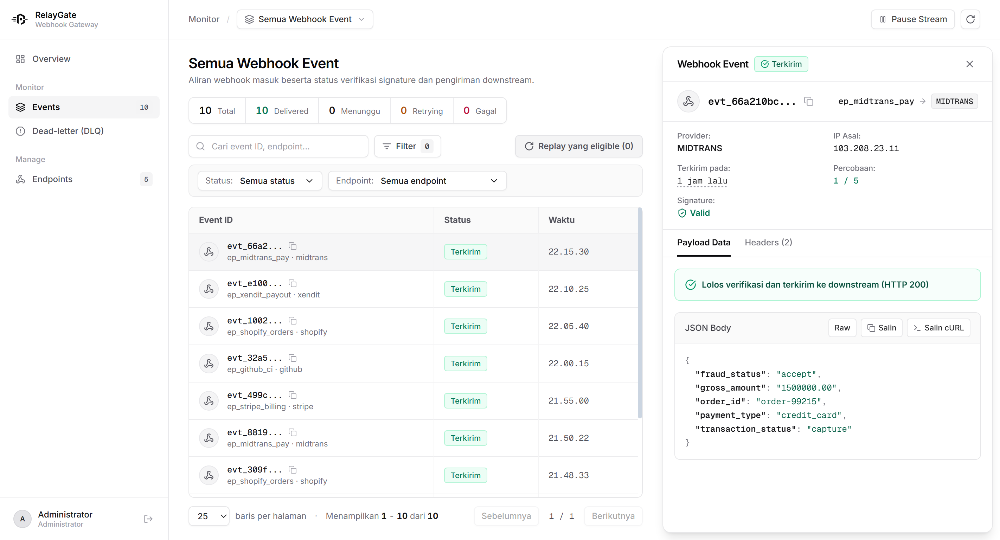

<p align="center">
  <a href="https://github.com/rootless-sec/relaygate">
    
  </a>
</p>

<h1 align="center">RelayGate</h1>

<p align="center">
  Self-hosted webhook ingestion gateway, cryptographic signature verifier, and dead-letter replay server compiled into a single Go binary with an embedded React console and SQLite WAL storage.
</p>

<p align="center">
  
</p>

---

Upstream providers (payment gateways, SaaS platforms, Git hosts) expire their webhook retry schedules if your backend is deploying, restarting, or returning errors. RelayGate sits in front of your services as a self-contained ingestion buffer and control plane.

When an HTTP POST request hits `/ingest/{endpoint_id}` (or `/v1/webhook/{endpoint_id}`), RelayGate checks endpoint status, applies optional upstream idempotency deduplication, writes the raw payload and headers synchronously to SQLite in Write-Ahead Logging (WAL) mode, returns `HTTP 200 OK` (`{"status": "queued"}`), and dispatches delivery asynchronously through a background worker pool.

---

## Supported Webhook Providers

`internal/verifier` validates incoming requests in constant time (`crypto/subtle.ConstantTimeCompare`) when an endpoint configures a `secret_key`. Endpoints without a `secret_key` record incoming events with `is_verified = 0`.

| Provider | Expected Header or Body Input | Verification Mechanism |
| :--- | :--- | :--- |
| `stripe` | `Stripe-Signature` (`t=...,v1=...`) | HMAC-SHA256 over `{t}.{raw_body}` with a 300-second timestamp tolerance window |
| `shopify` | `X-Shopify-Hmac-Sha256` | HMAC-SHA256 Base64 digest over raw body (falls back to unpadded `RawStdEncoding`) |
| `github` | `X-Hub-Signature-256` | HMAC-SHA256 hex digest with `sha256=` prefix |
| `midtrans` | `X-Midtrans-Signature` or JSON `signature_key` | SHA-512 hex digest of `order_id + status_code + gross_amount + server_key` |
| `xendit` | `X-Callback-Token` | Constant-time string comparison against the configured callback token |
| `doku` | `Client-Id`, `Request-Id`, `Request-Timestamp`, `Digest`, `Signature`, and `Request-Target` (or ingest path fallback) | Verifies `Digest: SHA-256=<base64>` and `Signature: HMACSHA256=<base64>` over the newline-joined component string |
| `flip` | Form field `token` (`application/x-www-form-urlencoded`) or header `X-Callback-Token` / `X-Flip-Token` | Constant-time token comparison against the endpoint validation token |
| `generic` | `X-Signature-SHA256`, `X-Hub-Signature-256`, `X-Signature`, `Signature`, or `X-RelayGate-Signature` | HMAC-SHA256 hex digest over raw body (`sha256=` and `sha256:` prefixes accepted) |

---

## Core Mechanics

### Ingestion, Idempotency & Multi-Target Fan-Out

1. The ingest handler enforces a 10 MB body limit (`10 << 20` bytes) and per-IP/endpoint sliding-window rate limits (default 120 requests per 10 seconds).
2. Internal auth spoofing headers (`X-User-Role`, `X-Admin`, `X-User-Email`, `X-User-Id`, `X-Forwarded-User`) are stripped before storage. If `Request-Target` is absent, the handler records the request path in `X-RelayGate-Request-Target` so DOKU signature verification can run asynchronously in the worker pool.
3. `model.ExtractIdempotencyKey` extracts upstream delivery identifiers from headers (`X-GitHub-Delivery`, `X-Shopify-Webhook-Id`, `Request-Id`, `X-Request-Id`, `Idempotency-Key`, `Webhook-Id`) or JSON fields (`order_id:status_code:transaction_status` for Midtrans, `order.invoice_number:transaction.status` for DOKU, or top-level `id` / `external_id`).
4. Before inserting into `idempotency_keys`, RelayGate checks that an explicit non-empty signature is not invalid so forged requests cannot poison deduplication. Duplicate deliveries for the same endpoint return `HTTP 200 OK` with `{"status": "duplicate_ignored"}`.
5. If an endpoint defines `destinations` or `target_urls`, RelayGate persists the primary event plus child `WebhookEvent` rows linked via `parent_event_id`. Each target URL runs through its own retry budget and delivery log history.

### Canonical Envelope & Outbound Signing

When `wrap_envelope` is enabled on an endpoint, `model.BuildCanonicalEnvelope` normalizes provider payloads into JSON containing `event_type`, `external_id`, `amount`, `currency`, and `raw_payload`. The worker attaches `X-RelayGate-Event-Type`, `X-RelayGate-External-ID`, and Standard Webhooks headers (`webhook-id: msg_{event_id}`, `webhook-timestamp`, and `webhook-signature: v1,<base64_hmac_sha256>` computed over `{msg_id}.{unix_ts}.{body}`).

### Circuit Breaker, `Retry-After` Deferral & Incident Notifications

The worker pool tracks consecutive delivery errors per `(endpoint_id, target_url)` key across `CLOSED`, `OPEN`, and `HALF_OPEN` states. After 5 consecutive network failures or HTTP `5xx` responses, the circuit opens for 60 seconds (or 1200ms when worker `PollInterval <= 200ms` in tests) and defers queued events via `DeferRetry` without incrementing `attempts`, while `HALF_OPEN` admits one probe at a time.

When a downstream target returns HTTP `429` or `503` with a valid `Retry-After` header (delta-seconds clamped between 2s and 86400s, or RFC HTTP-date), the worker calls `DeferRetry` to push `next_retry_at` without consuming an attempt.

Whenever an event transitions to `FAILED` (DLQ) or a circuit trips on consecutive `5xx`/network failures, `internal/notifier` sends JSON or email alerts to any configured `notification_url`, `telegram_webhook` (with optional `telegram_chat_id`), `discord_webhook`, `slack_webhook`, or `notification_email`, throttled to at most one alert per 5 minutes per endpoint.

### Dead-Letter Queue, Delivery Telemetry & Online Maintenance

Every worker attempt measures round-trip HTTP duration in milliseconds (`DurationMs`) and writes a row to `delivery_logs` (`attempt`, `code`, `ms`, `err`, `t`). Operators inspect attempt timelines, masked credential headers (`••••••••`), and failure classifications (`SIGNATURE_HEADER_MISSING`, `SIGNATURE_MISMATCH`, `SIGNATURE_TIMESTAMP_EXPIRED`, `SIGNATURE_TIMESTAMP_INVALID`, `SIGNATURE_PAYLOAD_MALFORMED`, `TIMEOUT`, `HTTP_5XX`, `HTTP_4XX`, `NETWORK_ERROR`, `DELIVERY_FAILED`) directly in the console.

<p align="center">
  
</p>

Eligible `FAILED` events can be replayed individually or in bulk (`POST /api/v1/events/bulk-replay`). Replaying resets `attempts` to 0, resets any open circuit breaker on the endpoint, and re-runs cryptographic verification if a secret key was rotated. Missing headers, expired timestamps, and malformed payloads are rejected as ineligible with a breakdown report.

For live operations, admins can trigger online SQLite snapshots via `POST /api/v1/system/backup` (`VACUUM INTO` validated by `PRAGMA foreign_key_check` under a dedicated `backupMu` lock). A background hourly ticker deletes `DELIVERED` events older than `RELAYGATE_RETENTION_DAYS` (default `30`) along with their delivery logs while keeping all `FAILED`, `PENDING`, and `RETRYING` rows intact.

---

## Quickstart

### Build and Run

```bash
# Clone the repository
git clone https://github.com/rootless-sec/relaygate.git
cd relaygate

# Build the React frontend assets (embedded into Go binary via go:embed)
npm --prefix ui install
npm --prefix ui run build

# Compile standalone Go binary (no CGO required; modernc.org/sqlite)
go build -o relaygate ./cmd/relaygate

# Start the server (default listen address :8080, DB ./data/relaygate.db)
./relaygate -addr 127.0.0.1:8080 -db ./data/relaygate.db -workers 10
```

Open `http://127.0.0.1:8080` in a browser to access the console. On first run with an empty `users` table, register an operator account via the Sign Up tab (the first user receives the `admin` role) or inspect the console log for the 6-digit dev OTP if `SMTP_HOST` is not configured.

### Run Verification Suites

```bash
# Run all Go unit, security, storage, notifier, and end-to-end tests
go test -count=1 ./...

# Run frontend component, formatter, masking, and bundle verification tests
npm --prefix ui test
```

---

## Documentation Index

| Document | Scope |
| :--- | :--- |
| [API Reference](docs/api.md) | Authentication, ingest responses, query filters, fan-out endpoint fields, replay, and system backup routes |
| [Configuration & Deployment](docs/configuration.md) | CLI flags, environment variables, dual SMTP setup (OTP vs incident notifier), Nginx/Caddy configs, and systemd unit |
| [Architecture & Internals](docs/architecture.md) | Request lifecycle, database schema, verification algorithms, circuit breaker state machine, and security controls |

---

## License

Apache-2.0. Built by [Rootless Security](https://github.com/rootless-sec).
