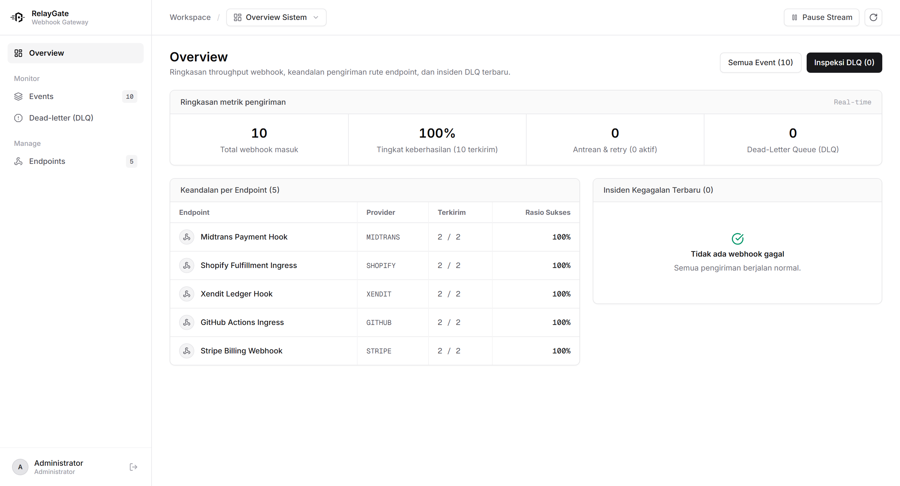
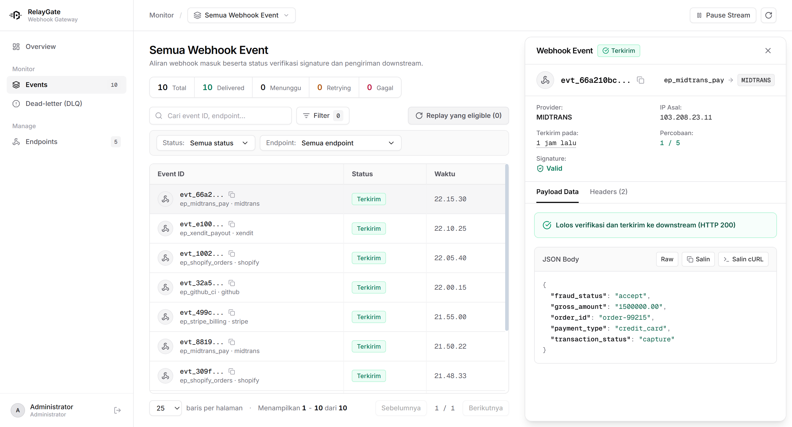

<p align="center">
  <a href="https://github.com/rootless-sec/relaygate">
    
  </a>
</p>

<h1 align="center">RelayGate</h1>

<p align="center">
  Self-hosted webhook ingestion gateway, cryptographic signature verifier, and dead-letter replay engine in a single Go binary.
</p>

<p align="center">
  
</p>

---

When upstream services (Stripe, Shopify, GitHub, Midtrans, Xendit) dispatch webhooks while your downstream application is restarting, deploying, or experiencing downtime, events are dropped once the provider exhausts its retry schedule.

RelayGate acts as an unprivileged, self-contained buffer and control plane in front of your internal services. When a webhook arrives at `/ingest/{endpoint_id}`, RelayGate writes the raw payload and headers synchronously to a local SQLite Write-Ahead Log (WAL), returns `202 Accepted` to the upstream provider, and delegates the event to a background dispatcher pool.

---

## Supported Webhook Providers

RelayGate cryptographically validates incoming signatures using constant-time comparison before downstream delivery:

| Provider | Signature Header | Verification Method |
| :--- | :--- | :--- |
| `stripe` | `Stripe-Signature` | HMAC-SHA256 timestamped tolerance window (`t=...,v1=...`) |
| `shopify` | `X-Shopify-Hmac-Sha256` | HMAC-SHA256 Base64 digest with unpadded fallback |
| `github` | `X-Hub-Signature-256` | HMAC-SHA256 hex digest (`sha256=` prefix) |
| `midtrans` | `X-Midtrans-Signature` | SHA-512 order digest (`order_id + status_code + gross_amount + key`) |
| `xendit` | `X-Callback-Token` | Constant-time static callback token comparison |
| `generic` | `X-RelayGate-Signature` | Standard HMAC-SHA256 hex signature |

---

## Dead-Letter Queue & Replay

If signature verification fails or downstream targets return `4xx`/`5xx` responses after exponential backoff, events move to the Dead-Letter Queue (DLQ).

<p align="center">
  
</p>

* **Granular Diagnostics:** Failure codes categorize errors (`SIGNATURE_MISMATCH`, `PAYLOAD_CORRUPT`, `DELIVERY_5XX`, `DELIVERY_TIMEOUT`).
* **Safe Replay:** Replaying resets attempts to 0, transitions status to `PENDING`, and re-verifies payloads if endpoint secrets were rotated.
* **Concurrency Protection:** In-flight keyed mutex guards prevent duplicate downstream dispatch during replays.
* **Credential Masking:** Sensitive headers (`Authorization`, `*Signature*`, `*Token*`, `*Secret*`) are masked as `••••••••` across API responses and logs.

---

## Quickstart

### 1. Build and Run

```bash
# Clone the repository
git clone https://github.com/rootless-sec/relaygate.git
cd relaygate

# Compile standalone Go binary (no CGO required)
go build -o relaygate ./cmd/relaygate

# Start the server (binds to 127.0.0.1:8080 by default)
./relaygate -addr :8080 -db ./data/relaygate.db -workers 10
```

Open `http://127.0.0.1:8080` in your browser to access the console.

### 2. Run Tests

```bash
# Run all Go unit, security, and integration tests
go test -race -count=1 ./...

# Run frontend test suite
npm --prefix ui test
```

---

## Documentation

Comprehensive technical documentation is organized in the [`docs/`](docs/) directory:

* **[API Reference](docs/api.md):** Complete REST API specifications, query filters, ingestion endpoints, and payload formats.
* **[Configuration & Deployment](docs/configuration.md):** CLI flags, environment variables, systemd service files, and Nginx/Caddy reverse proxy configurations.
* **[Architecture & Internals](docs/architecture.md):** SQLite WAL queue guarantees, provider verification mechanics, retry scheduler, and security invariants.

---

## License

Apache-2.0. Built by [Rootless Security](https://github.com/rootless-sec).
